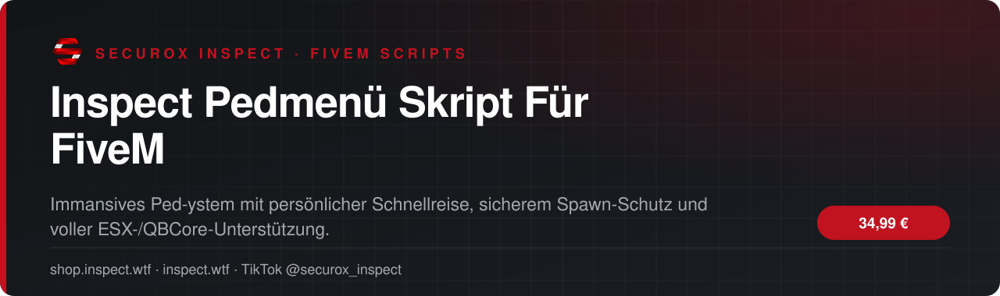
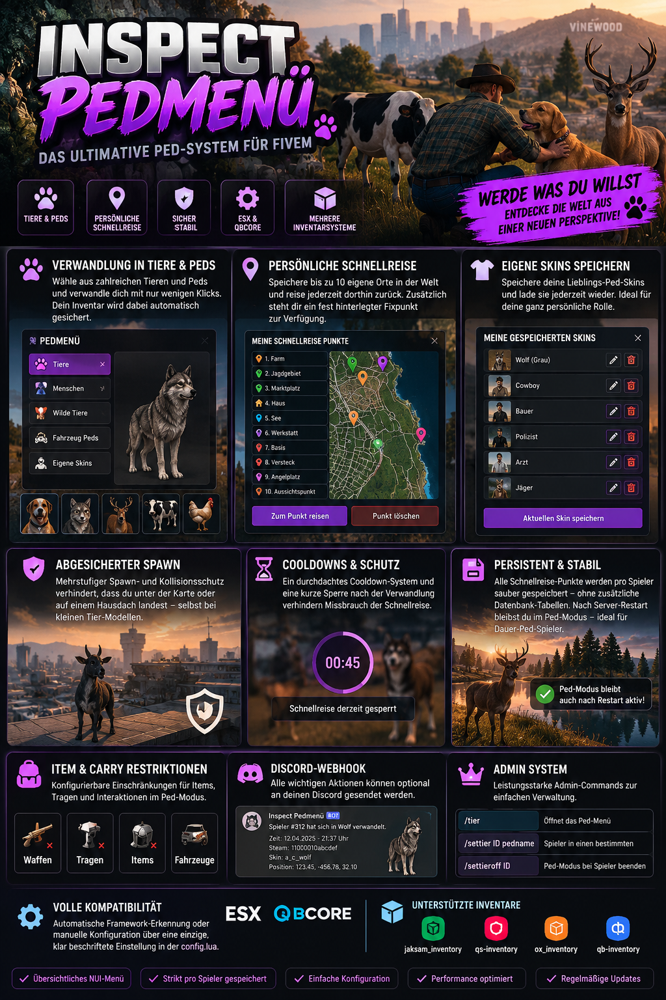
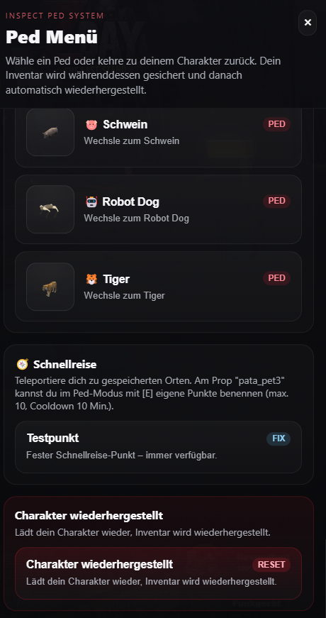

<!-- inspect-showcase: automatisch erzeugt, Änderungen bitte im Shop vornehmen -->

  
  
  
  
  

  
  
  

 

> 🇬🇧 **English:** Inspect Pedmenü Skript Für FiveM – FiveM script (ESX, QBCore) by SecuroX Inspect. Purchase and licensing exclusively at [shop.inspect.wtf](https://shop.inspect.wtf). Product details below are in German – questions are welcome on [Discord](https://discord.gg/inspect).

 

## Das Wichtigste auf einen Blick

<table>
  <tr>
    <td width="50%" valign="top">✔&nbsp; <b>Verwandlung in Tiere/Peds per Menü mit automatischer Inventar-Sicherung</b></td>
    <td width="50%" valign="top">✔&nbsp; <b>Abgesicherter Ped Modus zur Charakter-Trennung, nach Reconnect oder Server Neustart bleibt Ped Modus bestehen und bleiben im Ped</b></td>
  </tr>
  <tr>
    <td width="50%" valign="top">✔&nbsp; <b>Eigene Ped-Skins speichern und jederzeit wieder laden</b></td>
    <td width="50%" valign="top">✔&nbsp; <b>Schnellreise-System mit bis zu 10 persönlichen Punkten pro Spieler</b></td>
  </tr>
</table>

## Überblick

Das Inspect Pedmenü verwandelt Spieler wahlweise in Tiere oder andere Peds - inklusive automatischer Inventar-Sicherung, individuell speicherbarer Skins und einem eigenen Schnellreise-System. Jeder Spieler kann sich an dafür vorgesehenen Punkten in der Welt bis zu 10 persönliche Orte merken und dorthin zurückreisen, zusätzlich zu einem fest hinterlegten Fixpunkt. Ein mehrstufiger Spawn- und Kollisionsschutz sorgt dafür, dass niemand mehr unter der Karte oder auf einem Hausdach landet - selbst bei kleinen Tier-Modellen mit abweichender Kollisionshülle. Cooldowns und eine kurze Sperre direkt nach der Verwandlung verhindern Missbrauch der Schnellreise. Durch die integrierte Framework- und Inventar-Bridge läuft das Skript automatisch mit ESX oder QBCore sowie jaksam_inventory, qs-inventory, ox_inventory oder qb-inventory - konfigurierbar über eine einzige, klar beschriftete Einstellung in der config.lua.

## Kompatibilität

| | |
|:--|:--|
| Frameworks | **ESX** · **QBCore** |
| Unterstützte Ressourcen | `ox_inventory` |
| Plattform | FiveM (GTA V) |

## Alle weiteren Funktionen

- Fest hinterlegter Schnellreise-Fixpunkt (immer verfügbar)
- Punkte per Tastendruck an markierten Props im Ped-Modus benennen
- Eigene Punkte jederzeit im Menü löschbar
- Strikt getrennte Speicherung pro Spieler - keine Vermischung, auch bei gleichen Orten
- Cooldown-System gegen Missbrauch der Schnellreise
- Kurze Sperre direkt nach der Verwandlung
- Mehrstufiger Spawn- und Fallschutz
- Speziell abgesichert für kleine Tier-Modelle mit abweichender Kollisionshülle
- Carry- und Item-Restriktionen im Ped-Modus konfigurierbar
- ESX- und QBCore-Unterstützung (automatische Erkennung oder fest wählbar)

<b>9 weitere Funktionen anzeigen</b>

- jaksam_inventory-, qs-inventory-, ox_inventory- und qb-inventory-Unterstützung
- Zentrale Framework-/Inventar-Einstellung in der config.lua (auto oder manuell)
- Discord-Webhook-Integration
- Admin-Berechtigungssystem
- Persistente JSON-Speicherung ohne zusätzliche Datenbank-Tabellen für Schnellreise-Punkte
- Übersichtliches, eigenständiges NUI-Menü ohne fremde UI-Abhängigkeiten
- Nach Restart wieder im Pedmodus ohne wechseln zu müssen, ideal für Dauer Ped Spieler
- Player Commands: /tier um ins Ped Menü zu gelangen
- Admin Commands: /tier,/settier ID pedname, /settieroff ID

## Einblicke

<table>
  <tr>
    <td width="50%"></td>
    <td width="50%"></td>
  </tr>
</table>

## Preis

**34,99 €** &nbsp;–&nbsp; einmaliger Kaufpreis · Download und Lizenz im Kundenkonto

Sichere Zahlung mit PayPal oder Kreditkarte · Rechnung als PDF · Support auf Deutsch

## So einfach geht's

1. **Im Shop kaufen** – sicher bezahlen mit PayPal oder Kreditkarte.
2. **Sofort loslegen** – Download und Lizenz stehen direkt nach Zahlungseingang in deinem Kundenkonto bereit, die Rechnung erhältst du als PDF.
3. **Einrichten** – bei Fragen hilft dir unser Support im Discord weiter.

## Warum INSPECT?

<table>
  <tr>
    <td width="50%" valign="top"><b>🇩🇪 Entwickelt in Deutschland</b> Konzeption, Entwicklung und Support aus einer Hand.</td>
    <td width="50%" valign="top"><b>💬 Persönlicher Support</b> Schnelle Hilfe auf Deutsch im INSPECT Discord.</td>
  </tr>
  <tr>
    <td width="50%" valign="top"><b>🔒 Sichere Zahlung</b> PayPal oder Kreditkarte, Rechnung automatisch als PDF.</td>
    <td width="50%" valign="top"><b>⚡ Sofort verfügbar</b> Download und Lizenz direkt nach der Zahlung im Kundenkonto.</td>
  </tr>
</table>

## Häufige Fragen

<b>Wie erhalte ich das Produkt?</b>

 

Nach bestätigter Zahlung stehen Download und Lizenz in deinem Kundenkonto bereit. Die Rechnung erhältst du als PDF.

<b>Welche Frameworks werden unterstützt?</b>

 

ESX, QBCore – zusätzlich mit Unterstützung für ox_inventory.

<b>Bekomme ich Hilfe bei der Einrichtung?</b>

 

Ja – unser Support hilft dir im [INSPECT Discord](https://discord.gg/inspect) persönlich und auf Deutsch.

<b>Wo kaufe ich offiziell?</b>

 

Ausschließlich im INSPECT Shop unter [shop.inspect.wtf](https://shop.inspect.wtf). Angebote von Dritten stammen nicht von uns.

## Kontakt

| | |
|:--|:--|
| 🛒 Shop | [shop.inspect.wtf](https://shop.inspect.wtf) |
| 🌐 Website | [inspect.wtf](https://inspect.wtf) |
| 💬 Discord | [discord.gg/inspect](https://discord.gg/inspect) |
| 🎬 TikTok | [@securox_inspect](https://www.tiktok.com/@securox_inspect) |
| ✉️ E-Mail | [info@inspect.wtf](mailto:info@inspect.wtf) |

---

<b>SecuroX Inspect</b> · Offizielle Produktpräsentation · Dieses Repository enthält keinen Quellcode und keine Produktdateien. 
Kauf und Lizenzen ausschließlich über <a href="https://shop.inspect.wtf">shop.inspect.wtf</a> · Inhalte werden automatisch aus dem Shop aktualisiert.

